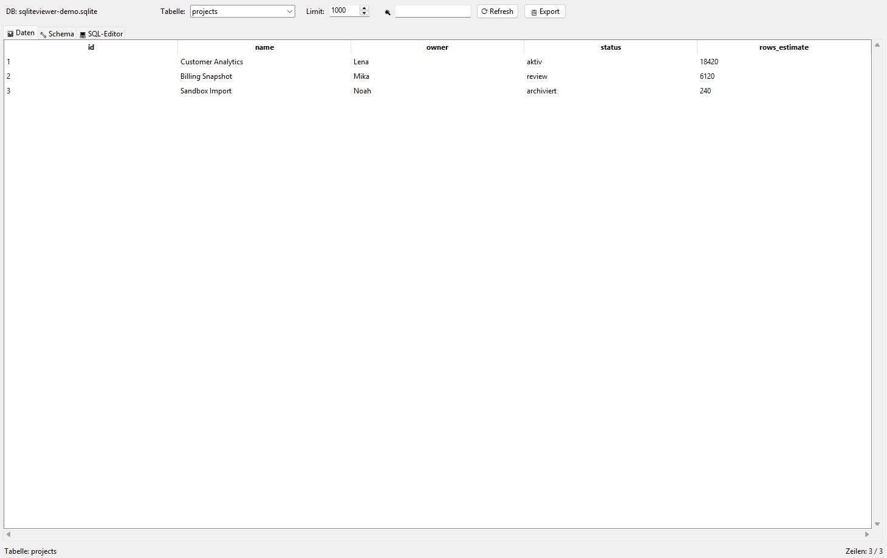
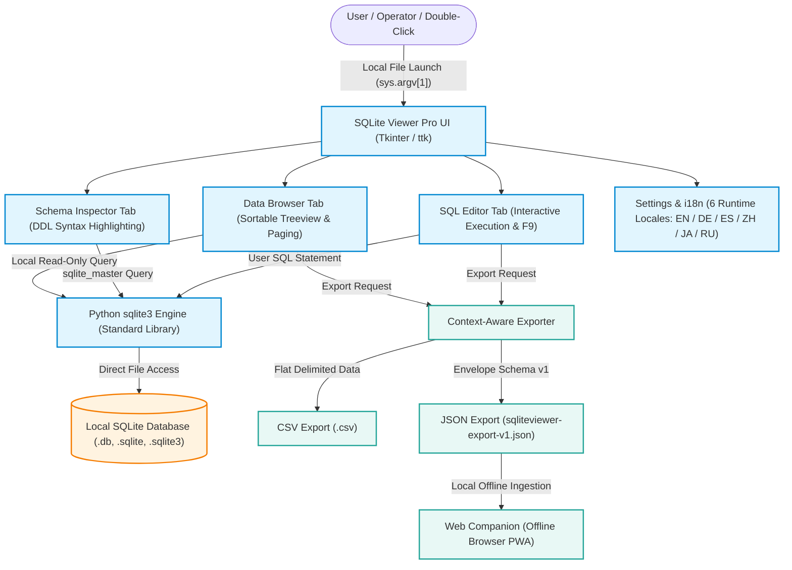
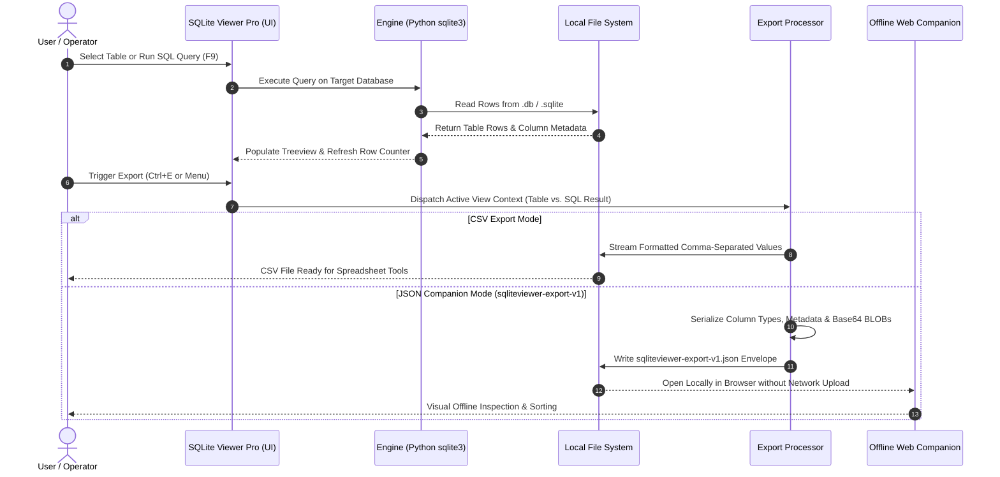

# SQLiteViewer

<p align="center">
  <a href="https://www.python.org/"></a>
  <a href="LICENSE"></a>
  <a href="NOTICE"></a>
  <a href="tests/"></a>
  <a href="tests/"></a>
  <a href="CONTRIBUTING.md"></a>
  <a href="THIRD_PARTY_LICENSES.txt"></a>
  <a href="store_package.json"></a>
  <a href="THIRD_PARTY_LICENSES.md"></a>
  <a href="THIRD_PARTY_LICENSES.md"></a>
  <a href="SECURITY.md"></a>
  <a href="https://github.com/file-bricks"></a>
  <a href="https://github.com/open-bricks"></a>
  <a href="llms.txt"></a>
</p>

<p align="center">
  <a href="README.md">English</a> | <a href="README_de.md">Deutsch</a> | <b>Español</b>
</p>

> [!NOTE]
> **SQLiteViewer** (comercializado en Windows como *SQLite Viewer Pro*) es un explorador local de bases de datos SQLite, sin privilegios, creado con Python estándar y Tkinter. Garantiza **cero tráfico de red saliente**, no requiere **dependencias externas de pip durante la ejecución** y funciona 100 % sin conexión. El contexto del proyecto legible por máquinas está indexado en [`llms.txt`](llms.txt).

---

## Navegación rápida

1. [¿Qué es SQLiteViewer?](#sec-01)
2. [Perfiles de usuario y facilidad de descubrimiento](#sec-02)
3. [Arquitectura y flujo de datos](#sec-03)
4. [Secuencia del ciclo de exportación](#sec-04)
5. [Matriz comparativa con alternativas](#sec-05)
6. [Funciones principales](#sec-06)
7. [Primeros pasos e instalación](#sec-07)
8. [Uso y flujo de trabajo](#sec-08)
9. [Atajos de teclado](#sec-09)
10. [Contrato de exportación y Companion](#sec-10)
11. [Microsoft Store y empaquetado](#sec-11)
12. [Gobernanza e invariantes del sistema](#sec-12)
13. [Licencias de terceros y transparencia](#sec-13)
14. [Ecosistema y proyectos relacionados](#sec-14)
15. [Seguridad y privacidad](#sec-15)
16. [Pruebas de contrato y verificación](#sec-16)
17. [Licencia y responsabilidad](#sec-17)

---

<a id="sec-01"></a>
## ¿Qué es SQLiteViewer?

**SQLiteViewer** es un explorador de escritorio ligero y portátil para archivos de base de datos `.db`, `.sqlite` y `.sqlite3`. Diseñado para desarrolladores, investigadores, administradores de sistemas y usuarios que cuidan su privacidad, permite abrir bases de datos al instante, inspeccionar tablas y definiciones de esquemas DDL, filtrar registros, ejecutar consultas SQL puntuales y exportar datos como CSV o JSON estructurado, todo ello sin conexión a la nube ni una pesada sobrecarga de ejecución de varios megabytes.



---

<a id="sec-02"></a>
## Perfiles de usuario y facilidad de descubrimiento

SQLiteViewer está diseñado para atender a cuatro perfiles principales sin fricciones:

### `[PERSONA-01]` Desarrolladores de Python y aplicaciones de escritorio
- **Perfil:** Ingenieros de software que crean aplicaciones Python (PySide, Tkinter, PyQt), FastAPI, Django o CLI y necesitan un inspector SQLite inmediato, sin instalación, para verificar fixtures de pruebas y archivos de estado.
- **Problema:** Esperar a que se inicie un IDE Java de más de 300 MB (DBeaver) o instalar binarios C++ de varios megabytes solo para inspeccionar una base de datos de prueba local de 20 KB.
- **Búsquedas de alta intención:**
  - `local-first SQLite viewer Python Tkinter`
  - `lightweight SQLite browser without bloat`
  - `inspect sqlite3 db from python app`
  - `python tkinter sqlite gui table browser`

### `[PERSONA-02]` Analistas e investigadores que cuidan la privacidad
- **Perfil:** Académicos, investigadores de datos sanitarios y analistas que trabajan con conjuntos de encuestas sensibles, aislados de la red, o con bases de datos clínicas.
- **Problema:** Los visores de bases de datos web modernos y los paneles conectados a la nube pueden facilitar la exfiltración de datos y vulnerar políticas institucionales estrictas de privacidad.
- **Búsquedas de alta intención:**
  - `offline SQLite database viewer zero network egress`
  - `air-gapped SQLite viewer privacy first`
  - `open source local SQLite explorer`
  - `private sqlite browser no telemetry`

### `[PERSONA-03]` DevOps, administradores de sistemas y soporte de TI
- **Perfil:** Equipos de respuesta a incidentes y técnicos de soporte que diagnostican errores en estaciones de trabajo de clientes donde no se permite elevar privilegios de administrador.
- **Problema:** Los instaladores tradicionales muestran avisos de UAC y dejan residuos en el Registro.
- **Búsquedas de alta intención:**
  - `portable SQLite viewer Windows unprivileged`
  - `inspect sqlite database RunAsInvoker`
  - `support triage sqlite viewer usb stick`
  - `portable sqlite table browser windows`

### `[PERSONA-04]` Usuarios finales de Microsoft Store y evaluadores no técnicos
- **Perfil:** Usuarios de Windows 10/11 que buscan una utilidad limpia y fiable para abrir archivos `.db` o `.sqlite` con un doble clic desde el Explorador de archivos.
- **Problema:** Windows no incluye un visor integrado de archivos SQLite, lo que puede llevar a recurrir a sitios de conversión en línea que no son de confianza.
- **Búsquedas de alta intención:**
  - `SQLite Viewer Pro Microsoft Store`
  - `Windows 11 open db file viewer`
  - `double click sqlite file Windows`
  - `sqlite viewer pro store id 9P6H501XB8JT`

---

<a id="sec-03"></a>
## Arquitectura y flujo de datos

SQLiteViewer se ejecuta en un único proceso sin privilegios (`RunAsInvoker`). La interfaz gráfica se conecta directamente al motor `sqlite3` integrado en Python, de modo que todas las operaciones con la base de datos permanecen en el equipo local.




### Topología arquitectónica visual de cuatro vistas

```text
+==================================================================================================+
|                          SQLITEVIEWER: FOUR-VIEW ARCHITECTURAL TOPOLOGY                          |
+==================================================================================================+
|                                                                                                  |
|  [VIEW 1: TKINTER GUI, USER INPUT & CLI INTEGRATION]                                             |
|  +--------------------------------------------------------------------------------------------+  |
|  | - Desktop Windowing: Tkinter / ttk unprivileged desktop GUI with native styling & palettes  |  |
|  | - Shortcut Dispatcher: Ctrl+O (open), Ctrl+F (search), Ctrl+E (export), F5 (refresh), F9 (SQL)|  |
|  | - Interactive Workspaces: Data Browser (Treeview & paging), Schema DDL, SQL Editor console   |  |
|  | - CLI & File Association: Direct database launch via sys.argv[1] & Windows double-click      |  |
|  +--------------------------------------------------------------------------------------------+  |
|                                                |                                                 |
|                                                v                                                 |
|  [VIEW 2: ATOMIC TRANSACTIONAL EXPORT & SERIALIZATION ENGINE]                                    |
|  +--------------------------------------------------------------------------------------------+  |
|  | - Context-Aware Dispatch: Dynamically resolves active view (Table records vs. SQL results) |  |
|  | - Format Serializers: Delimited streaming CSV exporter & structured JSON envelope          |  |
|  | - Export Envelope v1: sqliteviewer-export-v1 schema with source query & table metadata (INV)|  |
|  | - Atomic File Safety: Filename sanitization, parent directory creation & safe file replace  |  |
|  | - Web Companion Bridge: Zero-upload local offline dataset review via web_companion/        |  |
|  +--------------------------------------------------------------------------------------------+  |
|                                                |                                                 |
|                                                v                                                 |
|  [VIEW 3: SQLITE3 CORE DRIVER & DDL SCHEMA INTROSPECTION]                                        |
|  +--------------------------------------------------------------------------------------------+  |
|  | - Embedded Database Engine: Direct bindings to Python standard library sqlite3 (zero pip)  |  |
|  | - Schema Introspection: Queries sqlite_master for table DDL, indices, triggers & PRAGMAs    |  |
|  | - Defensive Query Pipeline: Parameterized queries, LIKE wildcard escaping & selection exec  |  |
|  | - Non-Destructive Exploration: Safe read-only connection mode protecting user databases    |  |
|  +--------------------------------------------------------------------------------------------+  |
|                                                |                                                 |
|                                                v                                                 |
|  [VIEW 4: RUNASINVOKER NON-ELEVATION, ZERO-EGRESS & AUDIT INTEGRITY]                             |
|  +--------------------------------------------------------------------------------------------+  |
|  | - Zero Network Egress Boundary: 100% offline air-gapped execution (INV-LOCAL-01)           |  |
|  | - RunAsInvoker Non-Elevation: Standard user privileges without UAC prompts (INV-LOCAL-02)   |  |
|  | - Level 1 SBOM Plain-Text Companion: THIRD_PARTY_LICENSES.txt Stand 2026-10-11 re-audited  |  |
|  | - Multi-Host Cloud-Sync Defense: Hardened .gitignore rules against sync conflicts & locks   |  |
|  +--------------------------------------------------------------------------------------------+  |
+==================================================================================================+
```


---

<a id="sec-04"></a>
## Secuencia del ciclo de exportación

Las operaciones de exportación siguen un protocolo estricto y consciente del contexto. La pestaña activa de la interfaz determina si se extraen registros de tablas o resultados de consultas SQL personalizadas.




---

<a id="sec-05"></a>
## Matriz comparativa con alternativas

SQLiteViewer está diseñado específicamente como un visor de escritorio local. La comparación con alternativas populares abarca diez criterios arquitectónicos:

| Dimensión | SQLiteViewer (`file-bricks`) | DB Browser for SQLite | DBeaver | SQLiteStudio | Cloud SQL SaaS |
|---|---|---|---|---|---|
| **Cero tráfico de red saliente** (`INV-LOCAL-01`) | **SÍ (100 % sin conexión)** | SÍ | NO (telemetría/actualizaciones) | SÍ | NO (la nube es obligatoria) |
| **Ejecución sin privilegios** (`INV-LOCAL-02`) | **SÍ (RunAsInvoker)** | SÍ | A menudo requiere administrador | SÍ | Entorno aislado del navegador |
| **Dependencias en tiempo de ejecución** (`INV-LOCAL-03`) | **Ninguna (biblioteca estándar de Python)** | Framework C++ / Qt | Pesadas (JVM ~300 MB) | Framework C++ / Qt | Servidor remoto |
| **Comportamiento no destructivo por defecto** (`INV-LOCAL-04`)| **SÍ (solo lectura por defecto)** | Centrado en la edición | Centrado en la edición | Centrado en la edición | Modificación remota |
| **Exportación dual según el contexto** (`INV-LOCAL-05`)| **SÍ (CSV + sobre JSON)**| Solo CSV | CSV, JSON, XML | CSV, JSON, HTML | Volcados en la nube |
| **Companion de navegador sin conexión** (`INV-LOCAL-06`)| **SÍ (`web_companion/`)** | NO | NO | NO | Aplicación web |
| **Empaquetado para Microsoft Store** (`INV-LOCAL-07`) | **SÍ (`9P6H501XB8JT`)** | Winget / MSI | Winget / MSI | Zip / Setup | Ninguno |
| **Licencia permisiva** (`INV-LOCAL-08`) | **MIT (sin copyleft)** | GPLv3 (copyleft) | Apache / propietaria | GPLv3 (copyleft) | Propietaria |
| **Paridad bilingüe EN/DE** (`INV-LOCAL-09`) | **Guías recíprocas EN/DE; 6 idiomas de interfaz (EN/DE/ES/ZH/JA/RU)** | Interfaz parcial | Interfaz parcial | Interfaz parcial | Solo inglés |
| **SLA de seguridad** (`INV-LOCAL-10`) | **SLA de respuesta de 48 horas** | Mejor esfuerzo de la comunidad | SLA comercial | Mejor esfuerzo de la comunidad | SLA del proveedor |

---

<a id="sec-06"></a>
## Funciones principales

- **Visor rápido de tablas:** Columnas ordenables, anchos ajustables y paginación adaptable para bases de datos con millones de registros.
- **Inspector interactivo de esquemas:** Consulta las sentencias DDL exactas `CREATE TABLE`, `CREATE INDEX` y `CREATE TRIGGER`.
- **Editor de consultas SQL:** Consola SQL multilínea con ejecución de consultas (`F9`), resaltado de errores y métricas de tiempo.
- **Búsqueda instantánea:** Filtrado dinámico por columna entre las filas de la tabla activa.
- **Exportación según el contexto:** Exporta las filas visibles directamente a CSV o JSON enriquecido (`sqliteviewer-export-v1.json`).
- **Internacionalización dinámica:** Cambia el idioma de la interfaz en tiempo de ejecución entre alemán, inglés, español, chino, japonés y ruso desde el menú.
- **Companion web sin conexión:** Explora conjuntos de datos JSON exportados en cualquier navegador moderno, sin instalar software ni ejecutar un servidor local.
- **Ejecutable único y listo para la Store:** Empaquetado para una distribución sencilla mediante Microsoft Store (*`SQLite Viewer Pro`*) o para ejecutar Python de forma independiente.

---

<a id="sec-07"></a>
## Primeros pasos e instalación

### Opción A: Microsoft Store (recomendada para Windows)

Instálalo directamente desde Microsoft Store para obtener asociaciones de archivos automáticas y actualizaciones en segundo plano:
- **Nombre del producto:** SQLite Viewer Pro
- **ID de Store:** `9P6H501XB8JT`
- **Enlace a Store:** [SQLite Viewer Pro en Microsoft Store](https://apps.microsoft.com/detail/9P6H501XB8JT)

### Opción B: Ejecutar desde el código fuente (todas las plataformas)

Requisitos previos: Python 3.10 o posterior (Tkinter se incluye en las distribuciones estándar de Python).

```bash
# Clone the repository
git clone https://github.com/file-bricks/SQLiteViewer.git
cd SQLiteViewer

# Run directly
python SQLiteViewer.py
```


Para abrir una base de datos concreta directamente:

```bash
python SQLiteViewer.py path/to/database.sqlite
```


---

<a id="sec-08"></a>
## Uso y flujo de trabajo

1. **Abrir una base de datos:** Pulsa `Ctrl+O` o arrastra un archivo `.db`, `.sqlite` o `.sqlite3` a la ventana.
2. **Inspeccionar tablas:** Selecciona una tabla en la barra lateral. La pestaña Datos muestra los registros en una cuadrícula ordenable.
3. **Filtrar registros:** Pulsa `Ctrl+F` para activar la barra de búsqueda, escribe la consulta y pulsa `Enter`.
4. **Inspeccionar el esquema:** Cambia a la pestaña Esquema para ver los tipos de columna, las claves primarias y las claves externas.
5. **Ejecutar SQL:** Cambia a la pestaña Editor SQL, redacta la consulta y pulsa `F9`.
6. **Exportar los datos visibles:** Pulsa `Ctrl+E` para abrir el cuadro de exportación. Elige entre CSV estándar y JSON estructurado `sqliteviewer-export-v1.json`.

---

<a id="sec-09"></a>
## Atajos de teclado

| Atajo | Acción | Ámbito |
|---|---|---|
| `Ctrl+O` | Abrir un archivo de base de datos SQLite | Global |
| `Ctrl+F` | Activar la barra de búsqueda y filtrado | Pestaña Datos |
| `Ctrl+E` | Iniciar la exportación según el contexto | Pestañas Datos / Editor SQL |
| `F5` | Actualizar los datos de la tabla actual | Pestaña Datos |
| `F9` | Ejecutar una consulta SQL | Pestaña Editor SQL |
| `Esc` | Borrar el filtro de búsqueda o cerrar el cuadro de diálogo | Global |

---

<a id="sec-10"></a>
## Contrato de exportación y Companion

SQLiteViewer implementa la especificación del esquema **`sqliteviewer-export-v1`** (documentada íntegramente en [`EXPORTFORMAT.md`](EXPORTFORMAT.md)). A diferencia de los volcados sin procesar, los sobres JSON exportados incluyen metadatos de procedencia estructurados:

```json
{
  "schema_version": "sqliteviewer-export-v1",
  "app_name": "SQLite Viewer Pro",
  "app_version": "2.1.0",
  "exported_at": "2026-09-14T17:50:00+02:00",
  "source": {
    "database_path": "C:/data/sample.sqlite",
    "database_name": "sample.sqlite",
    "view": "table",
    "table": "records",
    "query": null,
    "row_limit": 1000,
    "sort_column": "id",
    "sort_descending": false
  },
  "columns": ["id", "timestamp", "payload"],
  "row_count": 1,
  "result_rows": [
    {"id": 1, "timestamp": "2026-09-14 12:00:00", "payload": "Sample"}
  ]
}
```


El archivo exportado puede soltarse en la herramienta de navegador independiente [`web_companion/`](web_companion/) para inspeccionarlo inmediatamente en el cliente, sin transmitirlo por la red.

---

<a id="sec-11"></a>
## Microsoft Store y empaquetado

SQLiteViewer se distribuye como una aplicación estándar de Windows Desktop Bridge (*`SQLite Viewer Pro`*):
- **Identidad del paquete:** `Geiger.SQLiteViewerPro`
- **CN del editor:** `CN=52596601-BAB4-4F3F-B182-E8F3F273B202`
- **ID de Store:** `9P6H501XB8JT`
- **Alias de ejecución:** `sqliteviewer.exe`
- **Manifiesto:** `store_package.json` y `AppxManifest.xml`
- **Scripts de compilación:** `build_exe.bat` y `SQLiteViewer.spec`

---

<a id="sec-12"></a>
## Gobernanza e invariantes del sistema

SQLiteViewer cumple estrictamente los diez invariantes fundamentales del sistema de la familia de aplicaciones de escritorio `open-bricks` y `file-bricks`:

| Invariante | Título | Garantía de implementación |
|---|---|---|
| `INV-LOCAL-01` | **Cero tráfico de red saliente** | 100 % sin conexión. Sin solicitudes HTTP, analítica, telemetría ni sincronización en la nube. |
| `INV-LOCAL-02` | **Ejecución sin privilegios** | Se ejecuta con permisos de usuario estándar (`RunAsInvoker`). Sin avisos para elevar privilegios. |
| `INV-LOCAL-03` | **Cero dependencias externas en tiempo de ejecución** | Usa únicamente la biblioteca estándar de Python (`sqlite3`) y Tkinter. |
| `INV-LOCAL-04` | **Asociación de archivos no destructiva** | Exploración segura y de solo lectura por defecto. No modifica los archivos de base de datos al abrirlos. |
| `INV-LOCAL-05` | **Exportación dual según el contexto** | Extracción contextual de datos a CSV y a un sobre JSON estructurado. |
| `INV-LOCAL-06` | **Companion de navegador sin conexión** | Incluye un Companion HTML/JS sin dependencias (`web_companion/`) para revisar datos en el cliente. |
| `INV-LOCAL-07` | **Empaquetado estándar para Store** | Compatibilidad limpia con manifiestos AppX/MSIX e ID de Store verificado `9P6H501XB8JT`. |
| `INV-LOCAL-08` | **Código abierto 100 % permisivo** | Licencia MIT pura. Sin obligaciones de copyleft para las bases de datos ni las canalizaciones del usuario. |
| `INV-LOCAL-09` | **Paridad bilingüe EN/DE** | Las guías inglesa y alemana siguen siendo la base documental recíproca; la interfaz admite seis idiomas en tiempo de ejecución (EN/DE/ES/ZH/JA/RU). |
| `INV-LOCAL-10` | **SLA de seguridad y vulnerabilidades** | SLA documentado de respuesta en 48 horas para avisos de seguridad y vulnerabilidades. |

---

<a id="sec-13"></a>
## Licencias de terceros y transparencia

SQLiteViewer se basa exclusivamente en componentes de código abierto con licencias permisivas. La documentación completa de la auditoría está en [`THIRD_PARTY_LICENSES.md`](THIRD_PARTY_LICENSES.md).

- **Biblioteca estándar de Python:** `PSF-2.0` (permisiva, sin copyleft)
- **Sistema de ventanas Tcl/Tk:** `Tcl/Tk License` (permisiva, de estilo BSD)
- **Herramientas de desarrollo:** `pytest` (MIT), `ruff` (MIT / Apache-2.0)
- **Independencia de los datos del usuario:** Las bases de datos, los esquemas, las consultas y los conjuntos exportados siguen siendo propiedad exclusiva del usuario. El tratamiento de datos no está sujeto a condiciones de copyleft.

---

<a id="sec-14"></a>
## Ecosistema y proyectos relacionados

SQLiteViewer se mantiene en la organización [**file-bricks**](https://github.com/file-bricks) y forma parte de la suite de software de escritorio de código abierto [**open-bricks**](https://github.com/open-bricks).

Proyectos relacionados del ecosistema:
- [**LaunchBoards**](https://github.com/file-bricks/LaunchBoards): Lanzador local de espacios de trabajo controlado por teclado.
- [**SoftwareCenter**](https://github.com/file-bricks/SoftwareCenter): Gestor centralizado y sin privilegios de software y paquetes de Windows.
- [**ProSync**](https://github.com/file-bricks/ProSync): Motor determinista de sincronización de directorios locales y copias de seguridad diferenciales.
- [**ProFiler**](https://github.com/file-bricks/ProFiler): Analizador de sistemas de archivos y almacenamiento de alto rendimiento.
- [**CleanMarkdown**](https://github.com/doc-bricks/CleanMarkdown): Limpiador y formateador determinista de Markdown.

---

<a id="sec-15"></a>
## Seguridad y privacidad

- **Política de privacidad:** Lee la declaración completa en [`PRIVACY_POLICY.md`](PRIVACY_POLICY.md). SQLiteViewer no recopila telemetría ni transmite datos del usuario.
- **Política de seguridad y SLA:** Consulta [`SECURITY.md`](SECURITY.md) para conocer el procedimiento de divulgación de vulnerabilidades. Nos comprometemos a dar una **respuesta inicial en 48 horas** (`INV-LOCAL-10`).

---

<a id="sec-16"></a>
## Pruebas de contrato y verificación

La integridad de las funciones, las localizaciones y los metadatos de SQLiteViewer se verifica mediante una suite automatizada de pruebas pytest:

```bash
# Run all automated unit and contract tests
pytest -ra -v
```


La cobertura de las pruebas incluye:
- `tests/test_execute_sql.py`: Ejecución SQL y comportamiento de los resultados y exportaciones.
- `tests/test_i18n_translations_complete.py`: Completitud del catálogo de traducciones en seis idiomas de ejecución.
- `tests/test_i18n_translator.py` y `tests/test_i18n_gui_contract.py`: Contratos del traductor y del cambio de idioma de la interfaz en tiempo de ejecución.
- `tests/test_ui_accessibility.py`: Tooltips, navegación por teclado, atajos y diálogos.
- `tests/test_cli_db_argument.py`: Validación de rutas de archivo y manejo de parámetros de CLI.
- `tests/test_store_screenshots.py`: Generación de recursos gráficos de alta resolución y cumplimiento de las directrices de Microsoft Store.
- `tests/test_metadata.py`: Seguridad del banner (`HOOK-BANNER-ASSET-01`), sintaxis de Mermaid, contratos de metadatos y estructura documental, perfiles de usuario y matriz comparativa.

---

<a id="sec-17"></a>
## Licencia y responsabilidad

Este proyecto está distribuido bajo la [Licencia MIT](LICENSE).

### Responsabilidad (§ 521 BGB)

Este proyecto es una donación gratuita de software de código abierto en el sentido de los §§ 516 y siguientes del Código Civil alemán (BGB). La responsabilidad del autor se limita al dolo y a la negligencia grave conforme al § 521 BGB. Además, se aplica la exclusión de responsabilidad de la licencia MIT. El uso corre por cuenta y riesgo del usuario. No se ofrece compromiso de mantenimiento ni garantía de disponibilidad, de ausencia de errores o de idoneidad para un fin determinado.

*Este proyecto es una donación de software de código abierto sin contraprestación. La responsabilidad se limita al dolo y la negligencia grave (§ 521 del Código Civil alemán, BGB). Úselo bajo su propia responsabilidad. No se ofrece garantía, compromiso de mantenimiento ni garantía de idoneidad para un fin específico.*
