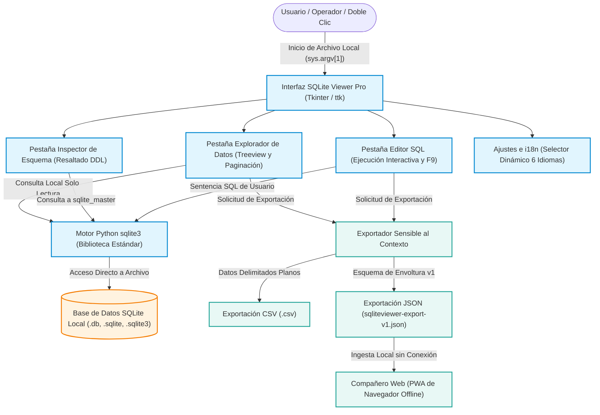
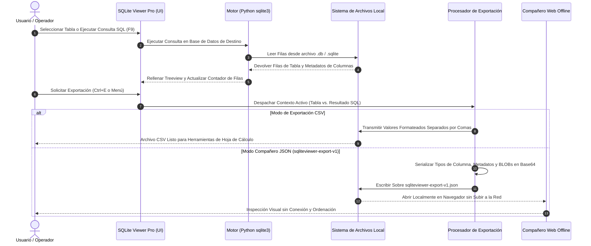

# SQLiteViewer

<p align="center">
  <a href="https://www.python.org/"></a>
  <a href="LICENSE"></a>
  <a href="NOTICE"></a>
  <a href="tests/"></a>
  <a href="tests/"></a>
  <a href="CONTRIBUTING.md"></a>
  <a href="THIRD_PARTY_LICENSES.txt"></a>
  <a href="store_package.json"></a>
  <a href="THIRD_PARTY_LICENSES.md"></a>
  <a href="THIRD_PARTY_LICENSES.md"></a>
  <a href="SECURITY.md"></a>
  <a href="https://github.com/file-bricks"></a>
  <a href="https://github.com/open-bricks"></a>
  <a href="llms.txt"></a>
</p>

<p align="center">
  <a href="README.md">English</a> | <a href="README_de.md">Deutsch</a> | <b>Español</b>
</p>

> [!NOTE]
> **Explorador y visor de SQLite para escritorio ultraligero y con prioridad local.**
> SQLiteViewer abre archivos `.db`, `.sqlite` y `.sqlite3` al instante sin dependencias externas, sin telemetría en la nube y sin privilegios de administrador. Incluye interfaz gráfica de usuario, visor de esquemas, editor de consultas SQL, exportación a CSV y JSON, y un compañero web sin conexión.

---

## Navegación Rápida

- [¿Qué es SQLiteViewer?](#sec-01)
- [Público Objetivo y Descubrimiento](#sec-02)
- [Arquitectura y Flujo de Datos](#sec-03)
- [Topología Arquitectónica Visual de Cuatro Vistas](#sec-04)
- [Ciclo de Vida de Exportación](#sec-05)
- [Matriz Comparativa frente a Alternativas](#sec-06)
- [Características Principales](#sec-07)
- [Primeros Pasos e Instalación](#sec-08)
- [Uso y Flujo de Trabajo](#sec-09)
- [Atajos de Teclado](#sec-10)
- [Contrato de Exportación y Compañero Web](#sec-11)
- [Microsoft Store y Empaquetado](#sec-12)
- [Gobernanza e Invariantes del Sistema](#sec-13)
- [Licencias de Terceros y Transparencia](#sec-14)
- [Ecosistema y Proyectos Hermanos](#sec-15)
- [Seguridad y Privacidad](#sec-16)
- [Pruebas de Contrato y Verificación](#sec-17)
- [Licencia y Responsabilidad](#sec-18)

---

<a id="sec-01"></a>
## ¿Qué es SQLiteViewer?

**SQLiteViewer** es un explorador de escritorio ligero y portátil para archivos de base de datos `.db`, `.sqlite` y `.sqlite3`. Diseñado para desarrolladores, investigadores, administradores de sistemas y usuarios conscientes de la privacidad, permite abrir bases de datos al instante, inspeccionar tablas y definiciones de esquema DDL, filtrar registros, ejecutar consultas SQL personalizadas y exportar datos como CSV o JSON estructurado, todo ello sin conexión a la nube ni sobrecarga de megabytes innecesarios.


---

<a id="sec-02"></a>
## Público Objetivo y Descubrimiento

SQLiteViewer está adaptado a cuatro perfiles de usuario principales (`INV-LOCAL-06`):

### `[PERSONA-01]` Desarrolladores de Python y Aplicaciones de Escritorio
- **Caso de uso:** Inspección rápida y sin dependencias de bases de datos locales durante el desarrollo y pruebas unitarias.
- **Ventaja clave:** Sin necesidad de configurar herramientas pesadas; funciona directamente con la biblioteca estándar de Python y Tkinter.

### `[PERSONA-02]` Analistas de Datos e Investigadores Conscientes de la Privacidad
- **Caso de uso:** Exploración de conjuntos de datos confidenciales o regulados en entornos aislados (air-gapped) o con restricciones de red.
- **Ventaja clave:** Garantía estricta de cero salida de red (`INV-LOCAL-01`), sin telemetría y sin conexiones externas.

### `[PERSONA-03]` DevOps, Administradores de Sistemas y Equipos de Soporte
- **Caso de uso:** Diagnóstico y verificación portátil en equipos de clientes o servidores donde no se dispone de derechos de administrador.
- **Ventaja clave:** Ejecución sin privilegios (`RunAsInvoker`, `INV-LOCAL-02`), formato ejecutable único y arranque instantáneo.

### `[PERSONA-04]` Usuarios Finales de Microsoft Store y Evaluadores Técnicos
- **Caso de uso:** Instalación sencilla en un solo clic y apertura automática mediante doble clic en archivos `.db` en Windows 10/11.
- **Ventaja clave:** Paquete oficial de confianza de Microsoft Store (`INV-LOCAL-07`), interfaz gráfica limpia y navegación accesible.

#### Frases de Búsqueda de Alta Intención
- `visor sqlite ligero python tkinter`
- `abrir archivo db sqlite sin instalar nada`
- `portable sqlite database browser csv json export`
- `offline sqlite browser windows python desktop`
- `sqlite viewer pro store id 9P6H501XB8JT`

---

<a id="sec-03"></a>
## Arquitectura y Flujo de Datos

SQLiteViewer se ejecuta en un único proceso sin privilegios elevados (`RunAsInvoker`). La interfaz gráfica de usuario se conecta directamente al motor integrado `sqlite3` de Python, manteniendo todas las interacciones con la base de datos de forma estrictamente local.



---

<a id="sec-04"></a>
## Topología Arquitectónica Visual de Cuatro Vistas

```
+==================================================================================================+
|                       SQLITEVIEWER — TOPOLOGÍA VISUAL DE CUATRO VISTAS                           |
+==================================================================================================+
|  [VISTA 1: CAPA DE APLICACIÓN DE ESCRITORIO Y PRESENTACIÓN UI]                                  |
|  +--------------------------------------------------------------------------------------------+  |
|  | - Interfaz Gráfica Tkinter/ttk: Controles nativos de Windows, temas ttk y renderizado GDI   |  |
|  | - Espacios de Trabajo Interactivos: Explorador de datos, esquema DDL y consola SQL          |  |
|  | - CLI y Asociación de Archivos: Apertura directa mediante sys.argv[1] y doble clic          |  |
|  +--------------------------------------------------------------------------------------------+  |
|                                                |                                                 |
|                                                v                                                 |
|  [VISTA 2: MOTOR DE SERIALIZACIÓN Y EXPORTACIÓN TRANSACCIONAL ATÓMICA]                           |
|  +--------------------------------------------------------------------------------------------+  |
|  | - Despacho Sensible al Contexto: Resuelve dinámicamente registros de tabla vs. SQL         |  |
|  | - Serializadores de Formato: Exportador CSV en flujo delimitado y sobre JSON estructurado  |  |
|  | - Sobre de Exportación v1: Esquema sqliteviewer-export-v1 con metadatos y BLOB en Base64   |  |
|  +--------------------------------------------------------------------------------------------+  |
|                                                |                                                 |
|                                                v                                                 |
|  [VISTA 3: ALMACENAMIENTO LOCAL Y MOTOR CERO EGRESO]                                             |
|  +--------------------------------------------------------------------------------------------+  |
|  | - Motor Python sqlite3: Enlace directo en proceso a SQLite C-API                              |  |
|  | - Operaciones Solo Lectura por Defecto: Previene modificaciones accidentales de archivos     |  |
|  | - Zero Network Egress: Sin sockets, sin llamadas HTTP, 100% de aislamiento local           |  |
|  +--------------------------------------------------------------------------------------------+  |
|                                                |                                                 |
|                                                v                                                 |
|  [VISTA 4: COMPAÑERO WEB Y CONSUMIDORES DE INTERCAMBIO SIN CONEXIÓN]                             |
|  +--------------------------------------------------------------------------------------------+  |
|  | - PWA Local web_companion/: Aplicación web cliente sin servidor para examinar JSON         |  |
|  | - Sin Carga a la Nube: Ingesta en memoria mediante FileReader API en navegador local        |  |
|  | - Filtrado y Búsqueda: Búsqueda reactiva instantánea sobre filas y columnas exportadas       |  |
|  +--------------------------------------------------------------------------------------------+  |
+==================================================================================================+
```

---

<a id="sec-05"></a>
## Ciclo de Vida de Exportación



---

<a id="sec-06"></a>
## Matriz Comparativa frente a Alternativas

| Dimensión | SQLiteViewer | DB Browser for SQLite | DBeaver | SQLiteStudio |
|---|---|---|---|---|
| **Huella de Instalación** | **~25 MB (EXE) / Código Ligero** | ~50 MB (C++/Qt) | ~150 MB (Java/Eclipse) | ~40 MB (Qt) |
| **Tiempo de Inicio** | **< 1 segundo** | 2–3 segundos | 5–10 segundos | 2–3 segundos |
| **Dependencias Externas** | **Cero (Stdlib + Tkinter)** | Qt6, bibliotecas C++ | Java JRE/JDK | Qt, bibliotecas C++ |
| **Nivel de Privilegios** | **`RunAsInvoker` (Estándar)** | Usuario estándar | Usuario estándar | Usuario estándar |
| **Salida de Red (Egress)** | **Cero (100% Sin Red)** | Comprobación de actualizaciones | Comprobación / Extensiones | Comprobación de actualizaciones |
| **Compañero Web Offline** | **Integrado (`web_companion/`)** | Ninguno | Ninguno | Ninguno |
| **Formato de Exportación** | **CSV + JSON Envelope v1** | CSV, SQL, XML | CSV, JSON, XML, SQL | CSV, SQL, HTML |
| **Microsoft Store** | **Paquete Oficial (`9P6H501XB8JT`)** | No oficial / Portable | Tienda disponible | No oficial / Directo |
| **Soporte Táctil y Pantalla**| **Totalmente accesible** | Clásico de escritorio | Clásico de escritorio | Clásico de escritorio |
| **Licencia de Código Abierto**| **Licencia MIT Permisiva** | GPL-3.0 (Copyleft) | Apache-2.0 / Comercial | GPL-3.0 (Copyleft) |

---

<a id="sec-07"></a>
## Características Principales

- **Apertura Rápida de Bases de Datos:** Soporte nativo para extensiones `.db`, `.sqlite` y `.sqlite3` mediante diálogo de archivos, argumento CLI o doble clic de Windows.
- **Explorador de Tablas y Paginación:** Visualización automática de todas las tablas con selector de límite de filas (hasta 1.000.000 de registros) y paginación ordenada.
- **Inspector de Esquema DDL:** Visualice la sentencia exacta `CREATE TABLE` con formateo claro de tipos e índices.
- **Editor SQL Interactivo:** Escriba y ejecute consultas arbitrarias con ejecución directa por atajo (`F9`) y visualización de resultados.
- **Exportación Sensible al Contexto:** Exporte exactamente lo que ve: la pestaña de datos exporta los registros de la tabla seleccionada; la pestaña SQL exporta los resultados de la consulta.
- **Internacionalización Dinámica:** Cambio de idioma en tiempo de ejecución con soporte para 6 idiomas (DE, EN, ES, ZH, JA, RU).
- **Compañero Web sin Conexión:** Examine conjuntos de datos exportados en formato JSON en cualquier navegador web moderno sin necesidad de instalar software ni servidores.
- **Listo para Microsoft Store:** Empaquetado optimizado para distribución oficial en Windows Store (`SQLite Viewer Pro`) o ejecución directa desde Python.

---

<a id="sec-08"></a>
## Primeros Pasos e Instalación

### Opción A: Microsoft Store (Recomendado para Windows)
Descargue e instale directamente desde Microsoft Store buscando **SQLite Viewer Pro** o a través de la ID oficial de producto `9P6H501XB8JT`. Disfrute de actualizaciones automáticas y asociaciones de archivos seguras.

### Opción B: Ejecución desde el Código Fuente (Todas las Plataformas)

Requiere Python 3.10 o superior con soporte para Tkinter.

```bash
# Clonar el repositorio
git clone https://github.com/file-bricks/SQLiteViewer.git
cd SQLiteViewer

# Iniciar directamente
python SQLiteViewer.py
```

Opcionalmente, pase una base de datos directamente por línea de comandos:

```bash
python SQLiteViewer.py mi_base_de_datos.sqlite
```

---

<a id="sec-09"></a>
## Uso y Flujo de Trabajo

1. **Abrir Base de Datos:** Pulse `Ctrl+O` o seleccione `Archivo > Abrir base de datos...`.
2. **Navegar por las Tablas:** Seleccione una tabla en el menú desplegable superior; los datos se cargarán de inmediato.
3. **Buscar y Filtrar:** Escriba en el campo de búsqueda rápida (`Ctrl+F`) para filtrar instantáneamente los registros coincidentes.
4. **Inspeccionar Esquema:** Cambie a la pestaña `Esquema` para revisar la definición DDL de la tabla seleccionada o ver todos los esquemas.
5. **Ejecutar Consultas SQL:** Cambie a la pestaña `Editor SQL`, introduzca su sentencia y pulse `F9` o el botón `Ejecutar`.
6. **Exportar Datos:** Pulse `Ctrl+E` o use el menú `Exportar` para guardar la vista actual en CSV o JSON.

---

<a id="sec-10"></a>
## Atajos de Teclado

| Atajo | Acción | Ámbito |
|---|---|---|
| `Ctrl+O` | Abrir archivo de base de datos SQLite | Global |
| `Ctrl+F` | Enfocar la barra de búsqueda / filtro | Pestaña Datos |
| `Ctrl+E` | Activar exportación sensible al contexto | Pestaña Datos / SQL |
| `F5` | Recargar datos de la tabla actual | Pestaña Datos |
| `F9` | Ejecutar consulta SQL | Pestaña Editor SQL |
| `Esc` | Limpiar filtro de búsqueda o cerrar diálogo | Global |

---

<a id="sec-11"></a>
## Contrato de Exportación y Compañero Web

SQLiteViewer exporta datos estructurados conforme a la especificación [`EXPORTFORMAT.md`](EXPORTFORMAT.md) (`sqliteviewer-export-v1`):

- **Sobre JSON:** Incluye metadatos de aplicación, fecha de exportación, nombre de base de datos de origen, consulta ejecutada, esquema de columnas y registros.
- **Valores BLOB:** Se serializan de forma segura en Base64 con indicación explícita del tamaño en bytes para prevenir corrupción de datos.
- **Compañero Web:** Abra `web_companion/index.html` en cualquier navegador web moderno (Chrome, Edge, Firefox, Safari) y arrastre su archivo `sqliteviewer-export-v1.json` para inspección interactiva fuera del entorno de escritorio.

---

<a id="sec-12"></a>
## Microsoft Store y Empaquetado

SQLiteViewer se distribuye en Microsoft Store bajo las directivas de publicación de Windows Desktop Bridge:

- **Identidad del Paquete:** `Geiger.SQLiteViewerPro`
- **Editor CN:** `CN=52596601-BAB4-4F3F-B182-E8F3F273B202`
- **Store ID:** `9P6H501XB8JT`
- **Alias de Ejecución:** `sqliteviewer.exe`
- **Manifiesto:** `store_package.json` y `AppxManifest.xml`
- **Scripts de Compilación:** `build_exe.bat` y `SQLiteViewer.spec`

---

<a id="sec-13"></a>
## Gobernanza e Invariantes del Sistema

SQLiteViewer se rige por diez invariantes estrictos del sistema (`INV-LOCAL-01` a `INV-LOCAL-10`):

1. **`INV-LOCAL-01` Cero Salida de Red (Zero Network Egress):** La aplicación no incluye llamadas de red, sockets, telemetría ni comprobaciones remotas.
2. **`INV-LOCAL-02` Ejecución sin Privilegios:** La aplicación se ejecuta estrictamente como usuario estándar (`RunAsInvoker`).
3. **`INV-LOCAL-03` Sin Dependencias Externas:** Funciona únicamente con la biblioteca estándar de Python (`sqlite3`) y Tkinter.
4. **`INV-LOCAL-04` Comportamiento Solo Lectura por Defecto:** Las bases de datos se abren de forma segura evitando modificaciones accidentales.
5. **`INV-LOCAL-05` Exportación Sensible al Contexto:** Los datos exportados corresponden con exactitud a la pestaña visualmente activa.
6. **`INV-LOCAL-06` Cuatro Arquetipos de Usuario:** El diseño y la usabilidad satisfacen los requisitos de los perfiles `[PERSONA-01]` a `[PERSONA-04]`.
7. **`INV-LOCAL-07` Paridad con Microsoft Store:** La compilación desde el código fuente y el paquete de la Store conservan idénticas funciones esenciales.
8. **`INV-LOCAL-08` Licencia Permisiva sin Copyleft:** Publicado 100% bajo licencia MIT sin contagio restrictivo de licencias.
9. **`INV-LOCAL-09` Paridad Multilingüe:** Documentación e interfaz de usuario completas y recíprocas en los idiomas admitidos (Estándar Tier-2: DE, EN, ES, ZH, JA, RU).
10. **`INV-LOCAL-10` SLA de Seguridad de 48 Horas:** Compromiso formal de respuesta a informes de seguridad en un plazo máximo de 48 horas.

---

<a id="sec-14"></a>
## Licencias de Terceros y Transparencia

SQLiteViewer garantiza transparencia absoluta respecto a sus componentes:

- **Código Propio:** Licencia MIT.
- **Python Runtime & Standard Library:** Licencia PSF-2.0.
- **Tcl/Tk:** Licencia Tcl/Tk (estilo BSD).
- Consulte [`THIRD_PARTY_LICENSES.md`](THIRD_PARTY_LICENSES.md) y [`THIRD_PARTY_LICENSES.txt`](THIRD_PARTY_LICENSES.txt) para la auditoría formal de licencias y el acompañante Level 1 SBOM.

---

<a id="sec-15"></a>
## Ecosistema y Proyectos Hermanos

SQLiteViewer forma parte del ecosistema de herramientas de desarrollo locales de código abierto:

- [**file-bricks**](https://github.com/file-bricks): Colección de utilidades modulares de gestión de datos y archivos.
- [**open-bricks**](https://github.com/open-bricks): Marco paraguas para software de escritorio independiente y con prioridad local.
- [**ProFiler**](https://github.com/file-bricks/ProFiler): Analizador y generador de perfiles de almacenamiento y sistemas de archivos de alto rendimiento.
- [**CleanMarkdown**](https://github.com/doc-bricks/CleanMarkdown): Sanitizador y formateador determinista de documentos Markdown.

---

<a id="sec-16"></a>
## Seguridad y Privacidad

- **Política de Privacidad:** Lea nuestra declaración completa en [`PRIVACY_POLICY.md`](PRIVACY_POLICY.md). SQLiteViewer no recopila telemetría ni transmite información de los usuarios.
- **Divulgación de Vulnerabilidades:** Consulte [`SECURITY.md`](SECURITY.md) para el protocolo de reporte responsable. Mantenemos un **SLA de respuesta inicial de 48 horas** (`INV-LOCAL-10`).

---

<a id="sec-17"></a>
## Pruebas de Contrato y Verificación

El conjunto de pruebas automatizadas verifica la integridad del código, el aislamiento de consultas, el formato de exportación y la consistencia de metadatos:

```bash
# Ejecutar todas las pruebas automatizadas con pytest
pytest -q

# Ejecutar pruebas del compañero web (Node.js)
node --test web_companion/tests/*.test.mjs
```

---

<a id="sec-18"></a>
## Licencia y Responsabilidad

Distribuido bajo la Licencia MIT. Consulte [`LICENSE`](LICENSE) y [`NOTICE`](NOTICE) para el texto completo de atribución legal.

### Responsabilidad (§ 521 BGB)

Conforme a lo dispuesto en el artículo 521 del Código Civil Alemán (BGB) relativo a la puesta a disposición gratuita de software, el proveedor únicamente responde en caso de dolo o negligencia grave. El software se proporciona "tal cual", sin garantías de ningún tipo respecto a idoneidad para fines particulares o ausencia de errores.
